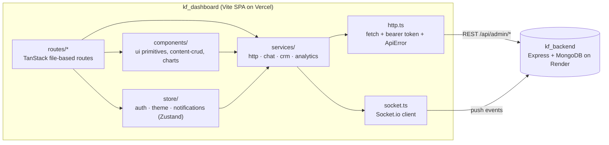

# KF Dashboard

[](https://github.com/kirollosfayezh/kf_dashboard/actions/workflows/ci.yml)

Admin control panel for KF Tech Solutions. Vite + React + TypeScript + TanStack
Router + Tailwind CSS, styled to match the brand mockup in
`../Homepage form responses (1)/Dashboard.dc.html` (dark theme by default with a
light-mode toggle, Space Grotesk / Instrument Sans / JetBrains Mono, orange→pink
gradient accents).

Everything — auth, content, leads, media, settings and live chat — comes from
`kf_backend`, the standalone Express + MongoDB server deployed on Render. Reads
and writes are plain REST under `/api`; live chat additionally opens a Socket.io
connection to the same origin, used purely as a push channel (every write still
goes through REST and the server emits the saved result back).

## Setup

Requires Node 22 (see `.nvmrc`).

```bash
npm ci
cp .env.example .env   # point VITE_API_BASE_URL at your API
npm run dev
```

### Environment variables (`.env`)

| Variable | Purpose |
|---|---|
| `VITE_API_BASE_URL` | Origin of the `kf_backend` server, with no trailing slash and no `/api` suffix (`http://localhost:4000` locally, `https://<service>.onrender.com` on Render). REST calls are made to `<VITE_API_BASE_URL>/api/…`; Socket.io connects to the origin itself, since the realtime server shares the HTTP server. |
| `VITE_SITE_URL` | Optional. Target of the sidebar's "View live site" link. |

## Auth

There is no signup screen. The single admin account is created by the backend's
`npm run seed-admin` script (see `kf_backend/README.md`), which hashes the
password from `SUPERADMIN_EMAIL` / `SUPERADMIN_PASSWORD`.

1. `POST /api/admin/auth/login` with `{ email, password }` returns
   `{ token, user: { id, email, name } }`.
2. The token is persisted to `localStorage` and sent as
   `Authorization: Bearer <token>` on every `/api/admin/*` request.
3. On load, `GET /api/admin/auth/me` re-validates the stored token; any 401
   clears it and bounces to `/login`.

## Running locally end-to-end

1. Start MongoDB (locally or point `MONGODB_URI` at an Atlas cluster).
2. In `kf_backend/`: `npm run seed-admin` once, then `npm run dev`.
3. In this folder: `npm run dev`, then sign in with the seeded credentials.

## Scripts

- `npm run dev` — start the Vite dev server (port 5174)
- `npm run build` — type-check (`tsc -b`) and build for production; fails fast
  if `VITE_API_BASE_URL` is not set, because the value is compiled in
- `npm run preview` — preview the production build locally
- `npm run lint` — oxlint (React, TypeScript and oxc rules)
- `npm run typecheck` — `tsc -b --noEmit`
- `npm test` — Vitest, once; `npm run test:watch` to keep it running

CI (`.github/workflows/ci.yml`) runs `npm ci`, lint, typecheck, test and build
on every push and pull request, then checks that the build did not change the
committed `src/routeTree.gen.ts`. It deploys nothing — deployment is Vercel's
job (`vercel.json`).

## Architecture



Screens are thin: a route composes `components/ui` primitives and calls a
service. Every request goes through `services/http.ts`; nothing else calls
`fetch` with credentials. Realtime is push-only — writes still go over REST.

The generic content editor shows the pattern used for the larger screens:

```
components/content-crud/
  ContentCrudScreen.tsx   composes the pieces below
  useContentItems.ts      list load, publish toggle, confirm-then-delete
  useContentEditor.ts     editor open/close, language tab, POST-or-PATCH save
  form-model.ts           pure FormState <-> ContentItem mapping (unit-tested)
  ContentList.tsx         table / cards / FAQ layouts
  ContentEditorForm.tsx   the editor form
  CollectionFields.tsx    sections only one collection shows
```

## Structure

- `src/routes/` — file-based TanStack Router routes (`__root.tsx` is the
  authenticated shell + responsive sidebar, `login.tsx` is public)
- `src/components/app-sidebar.tsx` — fixed rail from `lg` up, off-canvas drawer
  below it (the root route owns the open/close state)
- `src/components/ui/` — the design-system primitives (buttons, fields,
  dialogs, tables, feedback), one file per concern behind `ui/index.ts`;
  import them from `@/components/ui`
- `src/components/charts/` — SVG chart primitives for Analytics and Overview,
  each with a table twin so no value is hover-only
- `src/components/content-crud/` — the one generic list+form+delete screen
  reused by `projects`, `services`, `solutions`, `aboutSections`, `blogPosts`,
  `testimonials`, `faqs`, `legalPages` and `promos` (all share the same
  `ContentItem` shape)
- `src/services/http.ts` — fetch wrapper that prefixes `/api`, attaches the
  bearer token, turns network failures into a readable `ApiError` and redirects
  to `/login` on a 401
- `src/services/session.ts` — the `localStorage`-backed token
- `src/services/socket.ts` — lazy Socket.io client; the admin JWT travels in the
  handshake `auth`, which joins the connection to the server's `admins` room
- `src/services/chat.ts` — chat REST calls plus `subscribeToChat()`, which wires
  `chat:thread-updated`, `chat:message` and `chat:typing` and exposes
  `watch(visitorId)` for `chat:watch` / `chat:unwatch`
- `src/services/domain-types.ts` — TS types mirroring
  `kf_backend/src/shared/types.ts`
- `src/store/auth.ts` — JWT session state (Zustand)
- `src/store/theme.ts` — dark/light theme toggle, persisted to `localStorage`

## Responsive behaviour

The layout is built for 375px, 768px and 1280px:

- **Sidebar** — a fixed 250px rail at `lg` and up; below that it slides in as a
  drawer from a hamburger in the mobile top bar, with a scrim, and closes on
  navigation.
- **Tables** (inbox, content lists) — real CSS grids with column headings from
  `md` up; below that each row collapses into a stacked card. Nothing scrolls
  horizontally.
- **Forms** (settings, content edit) — auto-fit grids that fall to a single
  column on narrow screens.
- **Live chat** — two columns (threads / conversation) from `md` up. On mobile
  it's one column: the thread list, then the conversation with a back button.

## Chat data flow

A thread is addressed by its **`visitorId`**, not by the Mongo `id` that also
comes back on the document.

- `GET /api/admin/chat/threads` on mount fills the thread list.
- Opening a thread loads `GET /api/admin/chat/threads/:visitorId/messages` and
  emits `chat:watch` so that thread's `chat:message` events start arriving.
- Sending a reply `POST`s to `…/messages` with `{ text }` (the server sets
  `from: "agent"`). The socket echoes the saved message; appends are de-duped by
  message id, so a reply shows up exactly once whether the echo or the HTTP
  response lands first.
- `chat:thread-updated` fires for *every* thread and drives the list ordering
  and the unread badges.

## Testing

Tests are colocated as `*.test.ts` next to the code and run on Vitest. Pure
logic runs in Node; the two hook suites opt into jsdom with a
`// @vitest-environment jsdom` header and use Testing Library's `renderHook`.
The API is always mocked — no test touches the network or a real backend.

What is covered, and why:

- **Content form mapping** (`form-model.test.ts`) — the backend replaces a
  content item's `meta` wholesale on PATCH, so the editor must read-merge-write
  it. These tests pin that a save keeps keys the form does not expose, that a
  cleared input deletes its key, and the rating/sample coercions.
- **CRUD hooks** (`content-hooks.test.ts`) — load ordering, publish toggle,
  delete only after confirmation, POST for new vs PATCH for existing, and that
  a failed save keeps the editor open.
- **HTTP client** (`http.test.ts`) — URL building, bearer token, JSON vs
  `FormData` bodies, envelope unwrapping, 401 handling, network failures and
  the missing-`VITE_API_BASE_URL` diagnosis.
- **Reporting and formatting** — analytics gap-filling, period deltas, traffic
  channel classification and CSV export; chart axis/number scaling; CRM
  money/time/flag formatters; `toneForStatus`; the `tailwind-merge` config
  behind `cn()`.

Not covered: rendered screens and real browser behaviour (overlay placement,
responsive layout) — there are no component or end-to-end tests yet.

## Design decisions

- **One generic content screen.** Nine collections share the `ContentItem`
  shape, so they share one list/editor driven by props, with the few
  collection-specific fields in their own sections — rather than nine copies
  that drift.
- **Pure model, thin hooks, dumb views.** The data-safety rules live in
  `form-model.ts` with no React in it, which is what makes them cheap to test;
  hooks own requests and state; components only render.
- **Overlays portal to `document.body`.** Every screen animates in with a
  transform that stays applied, which makes it the containing block for
  `position: fixed`. `Modal` and `Drawer` render through a portal so they
  always cover the viewport.
- **Fail the build, not the user.** Without `VITE_API_BASE_URL` the bundle
  would call its own static host and every login would 405, so `vite build`
  refuses to run without it, and the HTTP client names the cause if it happens
  anyway.
- **Plain `fetch` + Zustand, no data-fetching library.** It is a single-admin
  tool with modest data; a small typed wrapper and per-screen state were
  enough. The trade-off is no request caching or deduping between screens.
- **oxlint over ESLint.** Fast enough to run on every save with zero config
  beyond the React hooks rule. The React-Compiler-style rules it ships
  (`set-state-in-effect`, `purity`, `refs`) are left as warnings: they flag
  real patterns in older screens, but fixing them is behaviour work, not lint.

## License

[MIT](LICENSE) © 2026 Kirollos Fayez
